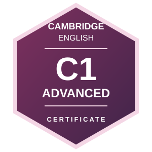

  

  

  I enjoy building creative, unconventional projects inspired by my interests. 
  With each new project, I challenge myself to build more ambitious and complex systems, 
  experimenting with different technologies and approaches as I work toward bringing my dream project to life.

 

<h2 align="center">Certifications</h2>

  
  
  
  
  

 

<h2 align="center">Skillset</h2>

<table align="center" width="100%">
  <tr>
    <td width="33%" valign="top">
      <h3 align="center">Frontend</h3>
      

        
      

    </td>
    <td width="33%" valign="top">
      <h3 align="center">Backend</h3>
      

        
      

    </td>
    <td width="33%" valign="top">
      <h3 align="center">DevOps &amp; Tools</h3>
      

        
      

    </td>
  </tr>
</table>
